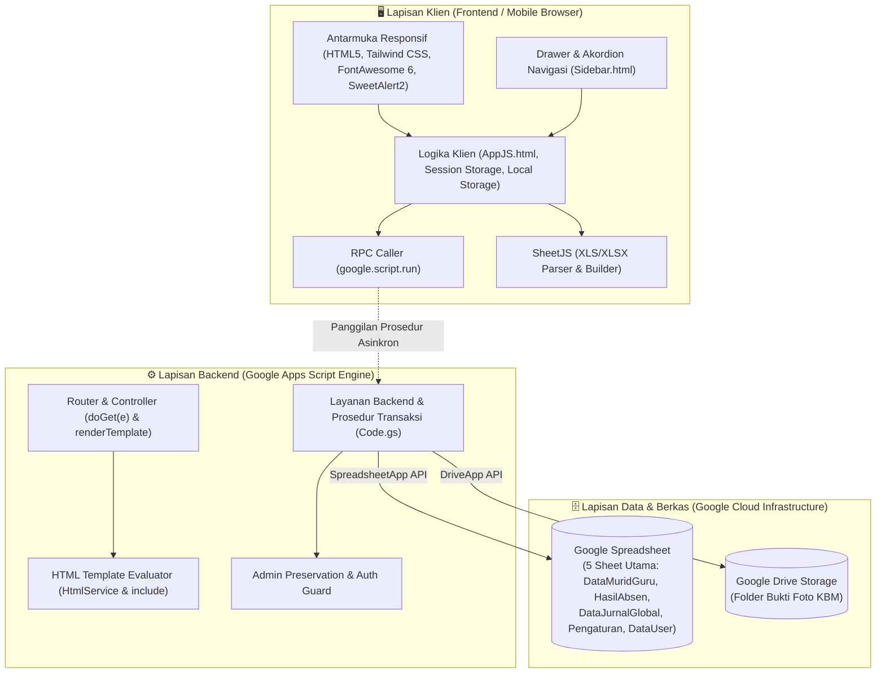
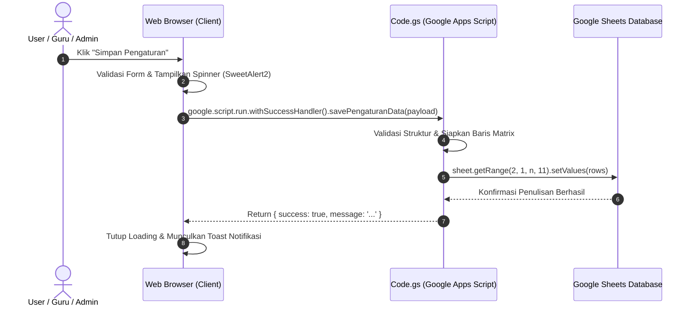

# ARSITEKTUR & TEKNIK PEMBUATAN WEB APLIKASI SIGURU v3.0

Sistem Informasi Guru Terpadu (Absensi Siswa & Jurnal Mengajar KBM) Berbasis Google Apps Script, Google Sheets Database, dan Google Drive Storage.

---

## 📌 1. Klasifikasi & Nama Teknik Arsitektur

Dalam rekayasa perangkat lunak web modern, arsitektur yang diterapkan dalam aplikasi ini diklasifikasikan ke dalam 8 pilar teknologi:

1. **Google Apps Script HTML Service — Server-Side Template Inclusion (Scriptlet Pattern)**
2. **Multi-Page Serverless Web Application (MPA) berbasis Query Parameter Routing**
3. **BaaS (Backend-as-a-Service) & Spreadsheet-Driven Database Architecture**
4. **Asynchronous Remote Procedure Call (RPC) Client-Server Communication via `google.script.run`**
5. **Two-Tier Role-Based Access Control (RBAC) dengan Field Auto-Locking & State Persistence**
6. **SheetJS Fast Excel Processing dengan Safe Administrator Preservation Engine**
7. **Dynamic Adaptive Print & PDF Engine (Smart Kop Divider & Source Data Injection)**
8. **Mobile-First Responsive Off-Canvas Drawer & Closed-by-Default Accordion Navigation**

---

## 🏗️ 2. Gambaran Umum Arsitektur Sistem

Aplikasi dibangun 100% tanpa server fisik (VPS), tanpa hosting berbayar (cPanel/Cloud Hosting), dan tanpa database engine SQL konvensional (MySQL/PostgreSQL). Seluruh sistem berjalan di atas infrastruktur **Google Cloud Platform (GCP)** secara serverless:



---

## 🧩 3. Bedah Teknik: Server-Side Template Inclusion (Scriptlet Pattern)

Setiap file tampilan web (seperti `Dashboard.html`, `FormAbsen.html`, `RekapAbsen.html`, `Pengaturan.html`, `UserManagement.html`) memiliki kerangka dokumen lengkap (`<!DOCTYPE html>`, `<html>`, `<head>`, `<body>`).

Komponen bersama (*shared components*) tidak diduplikasi, melainkan diinjeksi oleh server menggunakan **Scriptlet Inclusion** bawaan Google Apps Script:

```html
<!DOCTYPE html>
<html lang="id">
<head>
  <meta charset="UTF-8">
  <title>Rekap Absensi Siswa - SIGURU</title>
  <?!= include('StyleCSS'); ?>   <!-- 1. Injeksi Stylesheet Global & Pustaka Eksternal -->
</head>
<body class="bg-slate-50 text-slate-800 flex h-screen overflow-hidden">
  <?!= include('Sidebar'); ?>    <!-- 2. Injeksi Navigasi Sidebar Akordion -->

  <div class="flex-1 flex flex-col h-screen overflow-hidden w-full">
    <?!= include('Header', { pageTitle: 'Rekap Absen' }); ?> <!-- 3. Injeksi Navbar Atas -->
    
    <main class="flex-1 overflow-y-auto p-4 md:p-6 pb-24">
      <!-- Konten Khusus Halaman -->
    </main>
  </div>

  <?!= include('AppJS'); ?>      <!-- 4. Injeksi Logika Klien Global -->
</body>
</html>
```

### Jenis Scriptlet Google Apps Script

- `<?!= ... ?>` (**Force-Printing Scriptlet / Unescaped**): Mencetak blok kode HTML/CSS/JS dari file lain tanpa sanitasi encoding, sehingga browser merender komponen secara utuh.
- `<?= ... ?>` (**Printing Scriptlet / Escaped**): Mencetak data dengan sanitasi HTML (mencegah XSS).
- `<? ... ?>` (**Code Scriptlet**): Menjalankan logika kontrol server (`if/else`, perulangan) sebelum dokumen dikirim ke klien.

### Mesin Kompilator di Code.gs

```javascript
function include(filename, data) {
  try {
    var t = HtmlService.createTemplateFromFile(filename);
    t.currentPage = _activePage;
    t.params = _activeParams;
    t.appUrl = getAppUrl();
    if (data && typeof data === 'object') {
      for (var k in data) {
        if (data.hasOwnProperty(k)) t[k] = data[k];
      }
    }
    return t.evaluate().getContent();
  } catch (err) {
    return '<!-- Gagal memuat komponen "' + filename + '": ' + err.message + ' -->';
  }
}
```

---

## 🚦 4. Routing Multi-Page & Penanganan Iframe Sandbox

Google Apps Script hanya memiliki **satu URL induk** (Web App URL). Untuk menyajikan banyak halaman, digunakan teknik **Query Parameter Routing** (`?page=...`):

### Peta Rute di Code.gs

```javascript
var routeMap = {
  'dashboard': 'Dashboard',
  'form-absen': 'FormAbsen',
  'form-jurnal': 'FormJurnal',
  'rekap-absen': 'RekapAbsen',
  'hasil-jurnal': 'HasilJurnal',
  'master-data': 'MasterData',
  'user-management': 'UserManagement',
  'pengaturan': 'Pengaturan',
  'pengaturan-sistem': 'Pengaturan',
  'login': 'Login'
};
```

### Solusi Blank Putih & Navigasi Induk (`window.top.location.href`)

Aplikasi Web Apps Script berjalan di dalam **iframe sandbox** (`script.googleusercontent.com`). Jika berpindah halaman hanya menggunakan `window.location.href`, browser akan mengarahkan iframe ke URL domain terisolasi yang menyebabkan **blank putih** dan memutus tautan induk.

Solusi yang diterapkan pada [AppJS.html](file:///d:/Downloads/Share-DKV%20F/COBA/Absen&Jurnal%20Apps%20Script/AppJS.html):

```javascript
function navigateTo(page, params) {
  sessionStorage.setItem('siguru_active_page', page);
  localStorage.setItem('siguru_active_page', page);

  let baseUrl = getAppUrl();
  let url = baseUrl + '?page=' + encodeURIComponent(page);
  if (params && typeof params === 'object') {
    for (let k in params) {
      if (params.hasOwnProperty(k)) {
        url += '&' + encodeURIComponent(k) + '=' + encodeURIComponent(params[k]);
      }
    }
  }

  // Mengarahkan jendela induk (_top)
  try {
    if (window.top && window.top !== window) {
      window.top.location.href = url;
      return;
    }
  } catch (e) {}

  window.location.href = url;
}
```

**Manfaat Utama**:

1. Menghindari blank putih akibat pembatasan sandbox iframe.
2. Memperbarui query parameter di address bar browser secara nyata.
3. Saat pengguna me-refresh browser (menekan F5), aplikasi **tetap berada di halaman yang sedang aktif** dan tidak mental kembali ke Dashboard.

---

## 📂 5. Navigasi Akordion & Dukungan Mobile Responsif

### A. Grup Menu Buka-Tutup (Akordion)

Pada [Sidebar.html](file:///d:/Downloads/Share-DKV%20F/COBA/Absen&Jurnal%20Apps%20Script/Sidebar.html), menu dikelompokkan ke dalam 4 grup utama:

- **Menu Utama** (`#submenu-utama`): Form Presensi & Form Jurnal KBM.
- **Master Data** (`#submenu-master`): Data Murid & Guru.
- **Laporan & Rekap** (`#submenu-rekap`): Rekap Absen & Hasil Jurnal.
- **Pengaturan** (`#submenu-pengaturan`): Pengaturan Sistem & Manajemen User (*Khusus Admin*).

Fungsi `toggleNavGroup(key)` mengubah kelas `hidden` pada submenu, memutar ikon chevron (`-rotate-90`), dan menyimpan status ke `sessionStorage` (`siguru_nav_[key] = 'open' | 'closed'`). Saat halaman dimuat ulang, grup yang menaungi halaman aktif otomatis dibuka.

### B. Arsitektur Off-Canvas Drawer (Mobile Friendly)

1. **Sidebar Transformasi**:
   `class="... fixed md:relative inset-y-0 left-0 transform -translate-x-full md:translate-x-0 transition-all duration-300 ease-in-out z-50"`
   - Pada layar desktop (`md:`), sidebar bersifat statis di sebelah kiri.
   - Pada layar mobile (`< 768px`), sidebar bergeser keluar layar (`-translate-x-full`).
2. **Tombol Hamburger & Close**:
   - Tombol hamburger di navbar atas ([Header.html](file:///d:/Downloads/Share-DKV%20F/COBA/Absen&Jurnal%20Apps%20Script/Header.html)) memicu `toggleSidebar()` yang menambahkan kelas `translate-x-0`.
   - Tombol silang (*close button*) di pojok sidebar dan backdrop overlay gelap (`#sidebar-overlay`) menutup drawer seketika saat disentuh.
3. **Tabel Horisontal Adaptif**:
   Seluruh tabel data dibungkus elemen `overflow-x-auto w-full` dengan sel teks `whitespace-nowrap` sehingga dapat digeser mulus pada perangkat smartphone.

### C. Tombol Aksi Cepat Navbar (Icon-Only) & Pembersihan Cache Web

Pada navbar atas ([Header.html](file:///d:/Downloads/Share-DKV%20F/COBA/Absen&Jurnal%20Apps%20Script/Header.html)), seluruh tombol aksi dikemas dalam format **Icon-Only** (`w-9 h-9 sm:w-10 sm:h-10 rounded-xl`) dengan tooltip informatif guna mengoptimalkan ruang layar:

1. **Sinkron Data (`#btn-refresh`)**: Memanggil `refreshAllData()` untuk menyinkronkan data Google Sheets secara asinkron tanpa reload halaman.
2. **Hapus Cache Web & Refresh (`#btn-clear-cache`)**:
   - Memanggil `clearAppCache()` dengan modal konfirmasi SweetAlert2.
   - Saat dikonfirmasi, fungsi mengeksekusi `localStorage.clear()`, `sessionStorage.clear()`, serta membersihkan `window.caches` (Cache Storage API).
   - Melakukan reload penuh pada jendela induk (`window.top.location.reload()`) sehingga seluruh state browser bersih total.
3. **Login / Logout**: Tombol dinamis berbasis sesi untuk autentikasi cepat pengguna.

---

## 🛡️ 6. Sistem Keamanan, RBAC, & Field Auto-Locking

Aplikasi menerapkan sistem otorisasi Role-Based Access Control (RBAC) dua tingkat (*Two-Tier RBAC*):

### A. Tiga Tingkat Hak Akses

1. **Guest / Tamu**:
   - Akses hanya-baca (*read-only*) pada menu Laporan Rekap Absen dan Hasil Jurnal.
   - Tombol edit, hapus, dan penginputan data disembunyikan.
2. **Guru**:
   - Berhak melakukan presensi kelas dan pencatatan jurnal mengajar KBM.
   - Akses Laporan & Rekap dengan isolasi data mandiri.
3. **Administrator**:
   - Akses penuh (*Full Privileges*) ke seluruh menu, data guru, data siswa, dan grup Pengaturan.

### B. Personalisasi Dashboard & State Persistence

- Saat login berhasil, kredensial (`userRole`, `userName`, `namaGuru`, `nip`) disimpan secara sinkron pada `localStorage` dan `sessionStorage`.
- Fungsi `getLoggedInNamaGuru()` mencocokkan akun login dengan daftar guru master (`DataMuridGuru`). Jika login sebagai Admin, nama ditampilkan sebagai `"Administrator"`.
- Modul [Dashboard.html](file:///d:/Downloads/Share-DKV%20F/COBA/Absen&Jurnal%20Apps%20Script/Dashboard.html) mengeksekusi `updateDashboardWelcome()` untuk menampilkan salam hangat dinamis: `Selamat Datang, [Nama Guru]!`.

### C. Teknik Field Auto-Locking pada Form & Filter

Untuk mencegah manipulasi identitas penginput presensi dan jurnal oleh akun non-admin:

1. **Form Absen & Form Jurnal**:
   - Jika `role === 'Guru'`, input/dropdown `Nama Guru` otomatis diisi dengan nama guru yang login dan diberi atribut `disabled` / `readonly` serta styling visual terkunci (`bg-slate-100 cursor-not-allowed`).
   - Pada saat submit form, logika JavaScript memprioritaskan identitas guru dari session:

     ```javascript
     let guruVal = (currentRole === 'Guru') ? loggedInNamaGuru : document.getElementById('namaGuru').value;
     ```

   - Jika `role === 'Admin'`, dropdown `Nama Guru` terbuka penuh berisi seluruh daftar dewan guru.
2. **Rekap Absen & Hasil Jurnal**:
   - Jika `role === 'Guru'`, dropdown filter `Nama Guru` otomatis terkunci pada nama guru yang login.
   - Tombol aksi Edit dan Hapus hanya aktif untuk data yang diinput oleh guru bersangkutan.

---

## ⚡ 7. Integrasi SheetJS & Safe Administrator Preservation Engine

Pengelolaan data user massal pada [UserManagement.html](file:///d:/Downloads/Share-DKV%20F/COBA/Absen&Jurnal%20Apps%20Script/UserManagement.html) menggunakan pustaka **SheetJS (xlsx.full.min.js)** di sisi klien dan prosedur validasi proteksi di backend [Code.gs](file:///d:/Downloads/Share-DKV%20F/COBA/Absen&Jurnal%20Apps%20Script/Code.gs).

### A. Ekspor Data Excel Cepat (`.xls`)

- Data akun guru diekstrak langsung dari tabel DOM atau cache data user.
- **Isolasi Akun Admin**: Akun dengan role `Admin` secara otomatis difilter keluar dari array ekspor, sehingga file Excel yang diunduh hanya berisi daftar guru:

  ```javascript
  let exportData = allUsers.filter(u => String(u.role).toLowerCase() !== 'admin');
  ```

- File ditulis menggunakan format BIFF8 (`bookType: 'biff8'`) dengan ekstensi `.xls` agar kompatibel dengan seluruh versi Microsoft Excel, Google Sheets, dan LibreOffice.

### B. Safe Administrator Preservation Engine (Import Replace)

Skenario impor menggantikan (*replace*) seluruh akun lama dengan data baru dari file Excel. Untuk mencegah hilangnya akses admin sekolah, backend menerapkan algoritma preservasi:

```javascript
function importUsersFromExcel(usersArray) {
  var ss = getSpreadsheet();
  var sheet = ss.getSheetByName(SHEET_NAMES.USER);
  var data = sheet.getDataRange().getValues();

  // 1. Ekstrak dan amankan seluruh akun Administrator yang sudah ada
  var preservedAdmins = [];
  for (var i = 1; i < data.length; i++) {
    var role = String(data[i][3] || '').trim().toLowerCase();
    if (role === 'admin') {
      preservedAdmins.push([
        data[i][1], // Username
        data[i][2], // Password
        data[i][3], // Role ('Admin')
        data[i][4], // Nama Guru / Deskripsi
        data[i][5]  // NIP
      ]);
    }
  }

  // 2. Filter data dari file Excel agar tidak ada user non-admin yang menyelipkan role Admin
  var sanitizedNewUsers = [];
  usersArray.forEach(function(u) {
    var r = String(u.role || 'Guru').trim();
    if (r.toLowerCase() !== 'admin') {
      sanitizedNewUsers.push([u.username, u.password, 'Guru', u.namaGuru, u.nip]);
    }
  });

  // 3. Gabungkan akun Admin yang dilindungi dengan data Guru baru
  var finalRows = [];
  var counter = 1;
  preservedAdmins.forEach(function(adm) {
    finalRows.push([counter++, adm[0], adm[1], adm[2], adm[3], adm[4]]);
  });
  sanitizedNewUsers.forEach(function(usr) {
    finalRows.push([counter++, usr[0], usr[1], usr[2], usr[3], usr[4]]);
  });

  // 4. Bersihkan sheet lama dan tuliskan dataset gabungan
  sheet.getRange(2, 1, sheet.getLastRow(), 6).clearContent();
  sheet.getRange(2, 1, finalRows.length, 6).setValues(finalRows);
  return { success: true, count: finalRows.length };
}
```

**Hasil Rekayasa**:

- Seluruh akun Administrator tidak akan pernah terhapus atau tertimpa oleh file Excel.
- Tombol hapus pada baris Admin di tabel UI dinonaktifkan dengan lencana `[Dilindungi]`.
- Kolom Kata Sandi pada tabel mengadopsi mekanisme *Safe Obfuscation & Dynamic De-obfuscation* via tombol mata interaktif, mencegah intipan bahu (*shoulder surfing*) di ruang guru namun tetap mudah dikelola dan disalin saat dibutuhkan.

---

## 🖨️ 8. Dynamic Adaptive Print & PDF Engine

Modul cetak laporan pada [RekapAbsen.html](file:///d:/Downloads/Share-DKV%20F/COBA/Absen&Jurnal%20Apps%20Script/RekapAbsen.html) dan [HasilJurnal.html](file:///d:/Downloads/Share-DKV%20F/COBA/Absen&Jurnal%20Apps%20Script/HasilJurnal.html) mengimplementasikan perenderan cerdas untuk menghasilkan dokumen PDF berstandar dinas:

### A. Smart Kop Divider & Spacing

Header kop surat diambil dari Sheet `Pengaturan` Kolom F:

1. **Kop Berbasis Gambar (Image Banner)**:
   - Seringkali banner gambar resmi sekolah sudah memiliki garis pembatas di dalamnya.
   - Sistem secara otomatis mendeteksi format gambar via regex URL:

     ```javascript
     const isImg = /(https?:\/\/.*\.(?:png|jpg|jpeg|gif|webp|svg))|(drive\.google\.com)/i.test(kopVal);
     ```

   - Jika `isImg === true`, elemen garis pembatas `<div class="kop-divider"></div>` (garis biru ganda) **otomatis dihilangkan** dan margin bawah dirapatkan (`margin-bottom: 8px`), mencegah tampilan garis ganda yang bertumpuk merusak estetika kop.
2. **Kop Berbasis Teks**:
   - Jika berupa teks multiline instansi, sistem merender nama lembaga rata tengah dan menyertakan garis pembatas tebal ganda berstandar dinas (`border-top: 3px solid #1e40af; border-bottom: 1px solid #1e40af;`).

### B. Dynamic Source Data Injection (Pencantuman Sumber Data)

Sesuai regulasi transparansi data sekolah, setiap laporan cetak wajib mencantumkan sumber rujukan data:

1. **Rekap Absen**: Mengambil tautan/teks dari Sheet `Pengaturan` Kolom I (`linkHasilAbsen`).
2. **Hasil Jurnal**: Mengambil tautan/teks dari Sheet `Pengaturan` Kolom J (`linkHasilJurnal`).
3. **Injeksi Dual-Area**:
   - **Header Metadata**: Ditampilkan di samping kelas, semester, dan tahun ajaran:

     ```html
     <div style="font-size:11px; color:#475569;"><b>Sumber Data:</b> ${sumberData}</div>
     ```

   - **Document Footer**: Ditampilkan di pojok kiri bawah di samping stempel waktu cetak resmi (*Printed on ...*).

### C. Siklus Hidup Berkas Drive & Safe File Replacement (Edit Jurnal)

Pada modal edit jurnal ([HasilJurnal.html](file:///d:/Downloads/Share-DKV%20F/COBA/Absen&Jurnal%20Apps%20Script/HasilJurnal.html)), pengguna dapat melihat tautan bukti saat ini sekaligus memilih berkas bukti baru untuk diunggah:

1. **Pendeteksian Berkas Pengganti**: Jika pengguna memilih file baru pada input berkas, klien mengonversi file menjadi Base64 melalui `readFileBase64`.
2. **Pembersihan Berkas Lama di Google Drive**:
   - Backend [Code.gs](file:///d:/Downloads/Share-DKV%20F/COBA/Absen&Jurnal%20Apps%20Script/Code.gs) mengekstrak seluruh ID berkas/folder Drive dari tautan lama menggunakan ekspresi reguler `/(?:id=|file\/d\/|folders\/)([a-zA-Z0-9_-]{25,})/g`.
   - **Root Folder Guard**: Sistem membandingkan ID berkas lama dengan ID folder utama Google Drive (`folderIdDrive`). Jika ID tersebut bukan folder utama, berkas dipindahkan ke tempat sampah via `DriveApp.getFileById(cleanId).setTrashed(true)` atau `DriveApp.getFolderById(cleanId).setTrashed(true)`.
3. **Penyimpanan Berkas Baru**: Berkas baru diunggah ke folder Drive instansi, menghasilkan tautan baru yang otomatis disimpan ke Kolom M (13) Sheet `DataJurnalGlobal`.

### D. Dual-Mode Kop Surat Ingestion: Web URL vs Direct Google Drive Storage (Kolom K)

Pada menu **Pengaturan Sistem** ([Pengaturan.html](file:///d:/Downloads/Share-DKV%20F/COBA/Absen&Jurnal%20Apps%20Script/Pengaturan.html)), disediakan sistem *Mode Switcher* antara pengisian teks/URL dan unggah berkas fisik:

1. **Mode URL / Teks**: Menerima input URL gambar banner eksternal / Drive atau susunan teks resmi instansi.
2. **Mode Upload File Gambar**:
   - Pengguna memilih berkas gambar (PNG, JPG, WEBP).
   - `FileReader` pada klien membaca berkas ke format Base64 Data URL dan langsung merender gambar pada `#preview-kop-container` secara instan (*zero delay feedback*).
   - Saat formulir disimpan via `google.script.run.savePengaturanData(payload)`, backend [Code.gs](file:///d:/Downloads/Share-DKV%20F/COBA/Absen&Jurnal%20Apps%20Script/Code.gs) mendekode Base64, mengambil `folderIdDrive` dari Kolom K, membuat berkas via `folder.createFile(blob)`, menetapkan izin visibilitas tautan (`DriveApp.Access.ANYONE_WITH_LINK`), dan menyimpan URL Drive yang dihasilkan ke Kolom F Baris 2 Sheet `Pengaturan`.

### E. Dynamic Time-Based Greeting & Real-Time Local Hardware Clock Engine

Pada [Dashboard.html](file:///d:/Downloads/Share-DKV%20F/COBA/Absen&Jurnal%20Apps%20Script/Dashboard.html), sistem mengintegrasikan jam perangkat keras lokal (*Hardware Client Clock*) dan penyapa waktu adaptif:

1. **Logika Rentang Waktu (*Greeting Matrix*)**:
   - Pukul `04:00 - 10:59`: *Selamat Pagi*
   - Pukul `11:00 - 14:59`: *Selamat Siang*
   - Pukul `15:00 - 17:59`: *Selamat Sore*
   - Pukul `18:00 - 03:59`: *Selamat Malam*
2. **Sinkronisasi Detik (*Live Ticker Engine*)**:
   - Fungsi `updateDeviceDateTime()` berjalan setiap 1000 milidetik (`setInterval`) menggunakan nama hari dan bulan bahasa Indonesia (`id-ID`) untuk memformat `[Hari], [Tanggal] [Bulan] [Tahun] • [HH:mm:ss]`, memberikan impresi aplikasi yang hidup, dinamis, dan terhubung langsung dengan waktu nyata guru yang bertugas.

---

## 📱 9. Mobile-First Responsive Off-Canvas Drawer & Closed-by-Default Accordion Navigation

Komponen sidebar navigasi ([Sidebar.html](file:///d:/Downloads/Share-DKV%20F/COBA/Absen&Jurnal%20Apps%20Script/Sidebar.html)) dirancang dengan pola *Accordion Navigation* modern:

1. **Closed-by-Default Architecture**:
   - Seluruh kontainer submenu (`#submenu-utama`, `#submenu-master`, `#submenu-rekap`, `#submenu-pengaturan`) diinisialisasi dengan class `hidden` dan chevron indikator `-rotate-90`.
   - Mengurangi *visual clutter* saat pengguna pertama kali membuka aplikasi sehingga antarmuka tampak rapi, minimalis, dan tidak membebani ruang vertikal.
2. **Stateful Interaction & Session Preservation**:
   - Fungsi `toggleNavGroup(groupKey)` mengatur buka-tutup grup dan menyimpan status ke `sessionStorage.setItem('siguru_nav_' + groupKey, state)`.
   - Jika pengguna sengaja membuka grup tertentu, status tersebut dipertahankan selama sesi aktif browser tanpa membuka grup lainnya yang tidak relevan.

---

## 🗄️ 10. Struktur Skema Database 5 Sheet Terpadu

Sistem menggunakan 1 Google Spreadsheet dengan **5 Sheet Utama** yang saling berelasi:

```text
+-------------------------------------------------------------------------------------------------------+
| 1. DataMuridGuru                                                                                      |
| Kolom: NISN (A) | Nama Murid (B) | JK (C) | Kelas (D) | [Pemisah] (E) | Nama Guru (F) | NIP (G)       |
+-------------------------------------------------------------------------------------------------------+
| 2. HasilAbsen                                                                                         |
| Kolom: NISN (A) | Nama Murid (B) | JK (C) | Kelas (D) | Tanggal (E) | Keterangan (F) | Mapel (G) |     |
|        Semester (H) | Tahun Ajaran (I) | Nama Guru (J)                                                |
+-------------------------------------------------------------------------------------------------------+
| 3. DataJurnalGlobal                                                                                   |
| Kolom: Tanggal (A) | Nama Guru (B) | Semester (C) | TA (D) | Mapel (E) | Jam Ke (F) | Kelas (G) |     |
|        Pertemuan Ke (H) | Model Pembelajaran (I) | Materi Pembelajaran (J) | Murid Tdk Hadir (K) |    |
|        Ketuntasan Materi (L) | Bukti Kegiatan (M)                                                     |
+-------------------------------------------------------------------------------------------------------+
| 4. Pengaturan                                                                                         |
| Kolom: Nama Sekolah (A) | URL Logo (B) | Mapel (C) | Kelas (D) | TA (E) | Kop Surat (F) |             |
|        [Kosong] (G-H) | Link Hasil Absen (I) | Link Hasil Jurnal (J) | Folder ID Drive (K)            |
+-------------------------------------------------------------------------------------------------------+
| 5. DataUser                                                                                           |
| Kolom: No (A) | Username (B) | Password (C) | Role (D) | Nama Guru (E) | NIP (F)                     |
+-------------------------------------------------------------------------------------------------------+
```

### Teknik Pemindaian Matriks Seluruh Baris

Pada pembacaan Sheet `Pengaturan`, nilai Kolom I (`linkHasilAbsen`), Kolom J (`linkHasilJurnal`), dan Kolom K (`folderIdDrive`) dipindai di seluruh baris aktif (*full column scan*) dan di-cache pada level transaksi:

```javascript
for (var r = 1; r < data.length; r++) {
  if (!linkHasilAbsen && data[r][8]) linkHasilAbsen = String(data[r][8]).trim();
  if (!linkHasilJurnal && data[r][9]) linkHasilJurnal = String(data[r][9]).trim();
  if (!folderIdDrive && data[r][10]) folderIdDrive = String(data[r][10]).trim();
}
```

Teknik ini menjamin konfigurasi tidak hilang meskipun pengguna menyusun daftar kurikulum (Mapel, Kelas, Tahun Ajaran) dengan jumlah baris yang berbeda-beda.

---

## ⚡ 11. Komunikasi Klien-Server (Asynchronous RPC via `google.script.run`)

Frontend berkomunikasi dengan backend menggunakan pola asinkron yang dibungkus dengan Promise:



---

## 📊 12. Perbandingan Arsitektur: SIGURU vs Web Konvensional

| Dimensi Rekayasa | Web Konvensional (PHP / Laravel / Node.js) | Arsitektur SIGURU v3.0 (Google Cloud) |
| :--- | :--- | :--- |
| **Infrastruktur Server** | Membutuhkan sewa VPS / Cloud Server bulanan | **100% Serverless & Bebas Biaya Operasional** |
| **Sertifikat Keamanan** | Konfigurasi manual SSL / TLS Let's Encrypt | **Otomatis HTTPS** melalui domain resmi Google |
| **Database Engine** | MySQL / MariaDB / PostgreSQL | **Google Sheets** (Dapat diedit & dibackup langsung) |
| **Penyimpanan Berkas** | AWS S3 / MinIO / Local Directory Storage | **Google Drive** terintegrasi secara native |
| **Pembaruan Sistem** | Git Pull, migrasi database, restart service PM2 | **Penerapan Instan (Versioned Deployment)** |
| **Biaya Pemeliharaan** | Rutin patch OS, backup DB, perpanjangan hosting | **Zero Maintenance** (Dikelola penuh oleh Google) |

---

## 📝 13. Kesimpulan

Arsitektur **SIGURU v3.0** mengoptimalkan seluruh potensi ekosistem Google Workspace menjadi aplikasi web enterprise tingkat sekolah yang tangguh, aman, dan berdaya guna tinggi.

Dengan perpaduan **Server-Side Template Inclusion**, **Query Parameter Routing bebas blank putih**, **Two-Tier RBAC dengan Field Auto-Locking**, **SheetJS Fast Excel Processing dengan Safe Admin Preservation Engine**, serta **Dynamic Adaptive Print & PDF Engine**, aplikasi ini menjadi standar percontohan digitalisasi administrasi pendidikan modern yang hemat biaya, fleksibel, dan sangat mudah dirawat.
